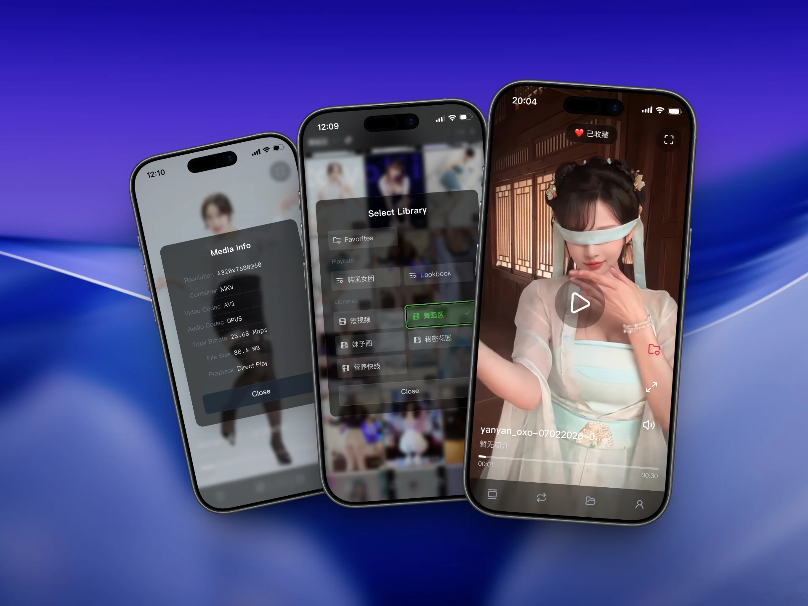
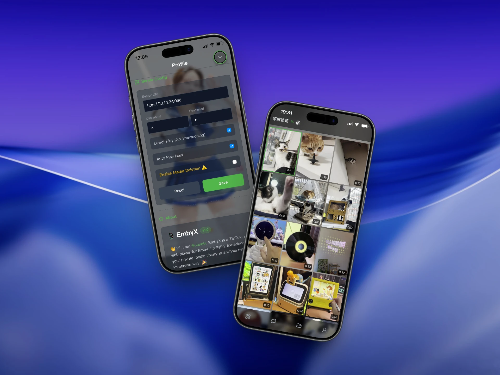

# 📱 EmbyX

🇨🇳 [中文说明](./README_zh.md)

EmbyX is a TikTok-style web player for Emby / Jellyfin and FygoOS. Experience your private media library in a whole new, immersive way. 🎉

[](https://github.com/juneix/embyx/releases)
[](https://github.com/juneix/embyx/stargazers)
[](https://github.com/juneix/embyx/forks)
[](https://hub.docker.com/r/juneix/embyx)
[](./LICENSE)
[](https://github.com/juneix/embyx)






## ✨ Features


**💡 Core**
- **Fluid Playback**: TikTok-style vertical scrolling for an **immersive** experience.
- **Direct Play**: Up to **8K HEVC / AV1** on Android—no transcoding.
- **Poster Wall**: Elegant album view with pagination and **shuffle**.
- **Emby Sync**: Real-time sync for **libraries, playlists, and favorites**.
- **Desktop Friendly**: Optimized for **keyboard & mouse**, Perfect for TV and PC.
- **PWA Ready**: Install as a **standalone** app on your home screen or desktop.
- **Privacy First**: All data stays **on your device**, no cloud uploads.

**💎 Bonus**
- **Short Drama Mode**: portrait viewing for TV Shows libraries and folder views
- **Cast to TV**: AirPlay, Chromecast, and DLNA supported
- **Auto-transcoding**: optimized for older devices or streaming on mobile data


## 🚀 Get Started

Try EmbyX instantly via the official web app:
- 🌐 **Main Site** - [embyx.5nav.eu.org](https://embyx.5nav.eu.org)
- ⚡ **Mirror Site** - [embyx.5nav.pp.ua](https://embyx.5nav.pp.ua)

Prefer full control? You can **self-host** EmbyX on your own server.

> This repo is open source — fork it and hack on it freely. Core features stay free forever.  
> 💎 "Player One" early access: try experimental features like Short Drama Mode, Casting, and Transcoding.

📚 Full Guide: [GitHub Wiki](https://github.com/juneix/EmbyX/wiki)

## 📢 Spread the Word

If EmbyX makes your digital life easier, please `star it on GitHub ⭐️`, or share it with your friends and the community! As an independent developer, your support is the best way to help this project grow.

> Love it? [Donations are welcome!](#❤️-support-the-project)


## 🔮 Playback Performance

| Device | HEVC Decode | AV1 Decode |
|:---:|:---:|:---:|
| Apple | A9 (2015) / M1 | A17 Pro (2023) / M3 |
| Android | Budget Phones (2016) | Budget Phones (2024) |
| PC | Intel 6-8th Gen iGPU | Intel 11th Gen+ iGPU |


## ⌨️ Shortcuts Guide

| Key | Action |
|:---:|---|
| `W / S / ↑ / ↓` | Prev / Next Video |
| `A / D / ← / → / Double Click Side` | Rewind / Forward 15s |
| `Space / Click OK` | Pause / Play |
| `T` | Cast to TV |
| `Y` | Actor Works |
| `U / Double Click OK` | Favorite Video |
| `H` | Add to Playlist |
| `J` | Toggle Aspect Ratio |
| `M` | Toggle Mute |
| `E / Tab 1` | Toggle View |
| `R / Tab 2` | Sequential / Random |
| `G / Tab 3` | Select Library |
| `I / Tab 4` | Profile |
| `F / Top Right` | Toggle Fullscreen |
| `V / Title Area` | Media Info |


## 📁 Directory Structure

```
embyx/
├── zh/               # Chinese Version
├── en/               # English Version
├── pic/              # Marketing & demo screenshots
├── docker/           # Docker deployment configurations
├── README.md         # English Documentation
└── README_zh.md      # Chinese Documentation
```


## 🚀 Deployment

### Option 1: Direct File Hosting (Recommended)

Simply put all files from `en/` folder into your web server (Nginx, Apache, etc.)

### Option 2: Docker Deployment

Don't want to mess with the environment? Just use Docker. Recommended GHCR for updates, Docker Hub for NAS.

- GHCR: `ghcr.io/juneix/embyx`
- Docker Hub: `juneix/embyx`

#### Docker CLI: 

```bash
docker run -d \
  --name embyx \
  --network host \
  -e APP_LANG=en \
  -e APP_PORT=8090 \
  ghcr.io/juneix/embyx
```
#### Docker Compose:
```yaml
services:
  embyx:
    image: ghcr.io/juneix/embyx
    # image: juneix/embyx # Docker Hub Mirror 
    container_name: embyx
    restart: unless-stopped
    network_mode: host
    environment:
      - APP_LANG=en # English Version
      - APP_PORT=8090 # Access Port
```

## ❤️ Support & Community

If you find EmbyX useful, consider supporting its development or joining our community. Your word-of-mouth and support help this project grow!

| Support | Community |
| :--- | :--- |
| [](https://ko-fi.com/juneixtse) | [](https://t.me/juneix_en) |
| [](https://paypal.me/juneixtse) | [](https://x.com/juneix_tse) |


## 🌟 Star History

[](https://star-history.com/#juneix/embyx&Date)


## 📝 License

MIT License — Feel free to use, PRs and Issues are welcome.
