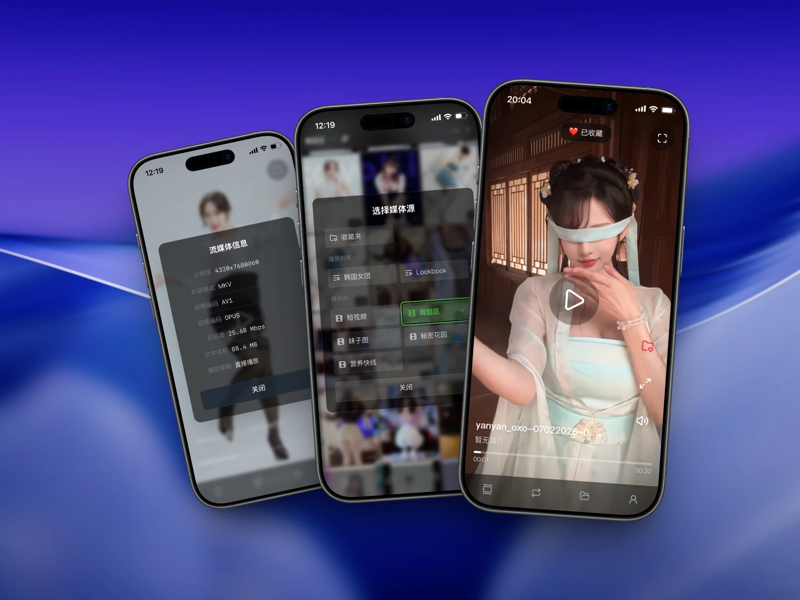
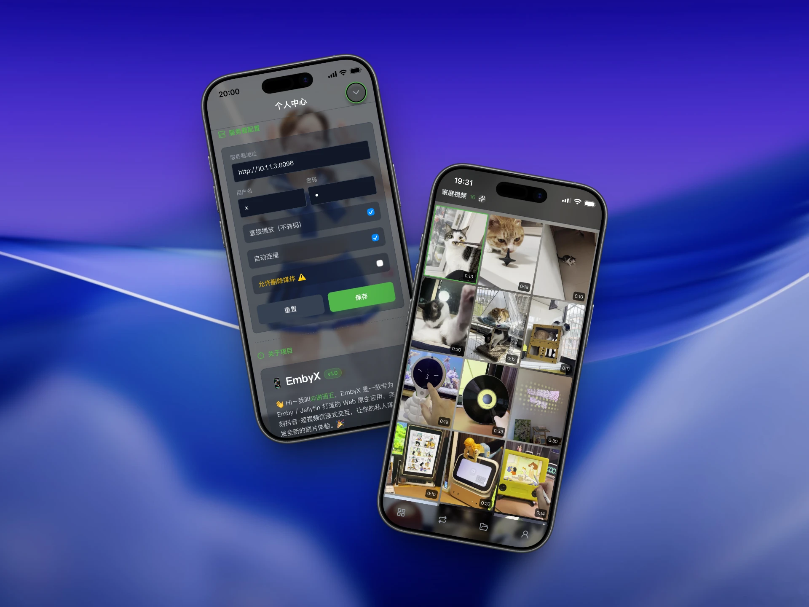

<p align="center">
  
</p>

# 📱 EmbyX


EmbyX 是一款专为 Emby / Jellyfin / 飞牛影视🔥/ OpenList 打造的 Web 原生应用，完美复刻抖音·短视频沉浸式交互，让你的私人媒体库焕发全新的刷片体验。🎉

[](https://github.com/juneix/embyx/releases)
[](https://github.com/juneix/embyx/stargazers)
[](https://github.com/juneix/embyx/forks)
[](https://hub.docker.com/r/juneix/embyx)
[](./LICENSE)
[](https://github.com/juneix/embyx)





## ✨ 功能特色

**💡 核心功能**
- **流式播放**：抖音操作习惯，沉浸式全屏体验
- **直接播放**：安卓最高支持 8K AV1 不转码
- **相册视图**：封面墙浏览，支持分页、换一批
- **Emby 同步**：支持媒体库、播放列表、收藏夹
- **键鼠适配**：纯按键控制，电脑、电视轻松摸鱼
- **PWA 支持**：添加到主屏幕 / 作为应用安装
- **隐私第一**：数据本地存储，绝不上传云端

**💎 头号玩家**
- **短剧模式**：支持电视库、文件夹视图，竖屏刷剧
- **电视投屏**：AirPlay、Chromecast、DLNA 投屏
- **自动转码**：适配部分老旧设备或外出流量场景


## 🚀 快速开始

推荐直接访问我的 EmbyX 官方网站，开箱即用：
- 🌐 **主站点** - [dy.5nav.eu.org](https://dy.5nav.eu.org)
- ⚡ **镜像站** - [dy.5nav.pp.ua](https://dy.5nav.pp.ua)

喜欢完全控制？你也可以自托管 EmbyX 应用。

> [!NOTE]
> EmbyX 的代码开源，核心功能永久免费。开发调试耗费了不少心思与 Token 成本，预览体验功能需「头号玩家」赞助解锁。    
>  
> 欢迎各位大佬 Fork 用于个人学习、二次开发；衍生版本对外发布请保留原项目出处，请勿直接发布移除/绕过解锁功能的版本。  

📚 完整使用教程: [谢週五の藏经阁](https://5nav.eu.org)

## 📢 广而告之

如果 EmbyX 让你的数字生活变得更轻松，请帮我点亮 GitHub ⭐️，或者把它安利给你的朋友！你也可以在 B 站、小红书、抖音或技术论坛（如 V2EX、LinuxDo、什么值得买、飞牛社区）上分享你的使用心得。作为独立开发者，大家的“自来水”是对我最好的支持。


## ❤️ 支持项目

- 打赏鼓励：支持我开发更多有趣应用
- 互动群聊：加入 💬 [QQ 群](https://qm.qq.com/q/ZzOD5Qbhce) 可在线催更
- 更多内容：访问 ➡️ [谢週五の藏经阁](https://5nav.eu.org)

<div align="center">
  <table>
    <tr>
      <td align="center">
        <br/>
        <sub>微信</sub>
      </td>
      <td align="center">
        <br/>
        <sub>支付宝</sub>
      </td>
    </tr>
  </table>
</div>

## 🔮 播放性能

| 设备 | HEVC 硬解 | AV1 硬解 |
|:---:|:---:|:---:|
| 苹果 | A9 (2015) / M1 | A17 Pro (2023) / M3 |
| 安卓 | 千元机 (2016) | 千元机 (2024) |
| PC | 6～8 代酷睿·核显 | 11 代酷睿·核显 |

---

## ⌨️ 快捷键指南

| 按键 | 功能 |
|:---:|---|
| `W / S / ↑ / ↓` | 上一个 / 下一个视频 |
| `A / D / ← / → / 双击侧边` | 快退 / 快进 15 秒 |
| `Space / 单击 OK` | 暂停 / 播放 |
| `T` | 电视投屏 |
| `Y` | 演员作品 |
| `U / 双击 OK` | 收藏视频 |
| `H` | 添加播放列表 |
| `J` | 比例切换 |
| `M` | 音量开关 |
| `E / Tab 1` | 视图切换 |
| `R / Tab 2` | 顺序 / 随机 |
| `G / Tab 3` | 选择媒体源 |
| `I / Tab 4` | 个人中心 |
| `F / 右上角` | 全屏切换 |
| `V / 标题区` | 流媒体详情 |

---

## 📁 文件目录

```
embyx/
├── zh/               # 中文版资源
├── en/               # 英文版资源
├── pic/              # 图片素材
├── docker/           # Docker 配置文件
├── README.md         # 英文说明文档
└── README_zh.md      # 中文说明文档
```

---

## 🚀 部署方式

### 方式一：直接托管（推荐）

只需将 `zh/` 文件夹中的所有文件放入你的 Web 服务器（Nginx、Apache 等）根目录即可。

### 方式二：飞牛应用

EmbyX 即将上架飞牛商店（审核中），加入交流群可下载 fpk 文件手动安装。

### 方式三：Docker 部署

不想折腾 Web 环境？那就直接 Docker 搞定。推荐使用 GHCR 获取更新；NAS 用户可使用 Docker Hub。

#### 使用 Docker CLI: 
```bash
docker run -d \
  --name embyx \
  --network host \
  -e APP_LANG=zh \
  -e APP_PORT=8090 \
  ghcr.io/juneix/embyx
  # docker.1ms.run/juneix/embyx # 毫秒镜像加速
```

#### 使用 Docker Compose:
```yaml
services:
  embyx:
    image: ghcr.io/juneix/embyx 
    # image: docker.1ms.run/juneix/embyx  # 毫秒镜像加速
    container_name: embyx
    restart: unless-stopped
    network_mode: host
    environment:
      - APP_LANG=zh # 中文版
      - APP_PORT=8090 # 访问端口
```


## 🌟 Star History

[](https://star-history.com/#juneix/embyx&Date)


## 📝 开源协议

MIT License — 随意使用，欢迎 PR 和 Issue。
